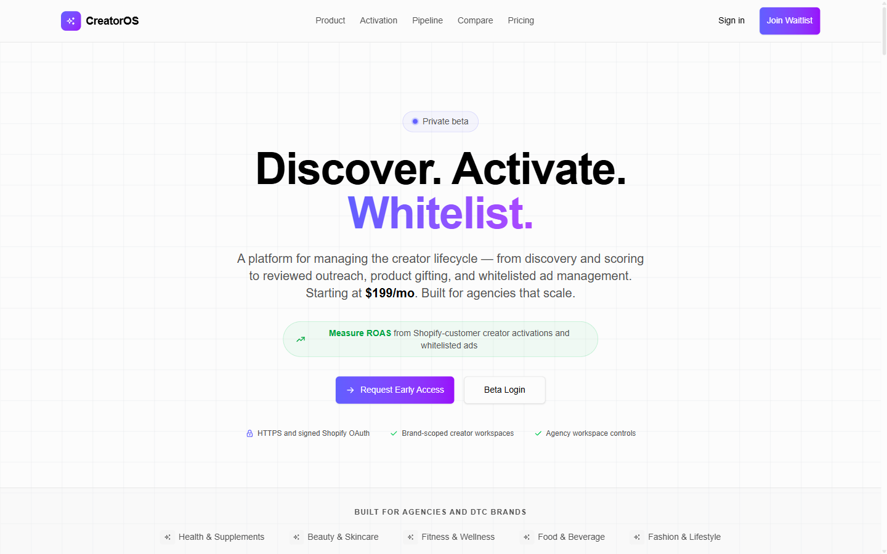
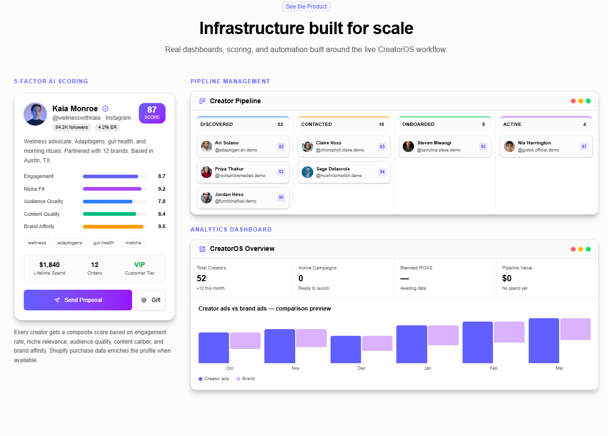
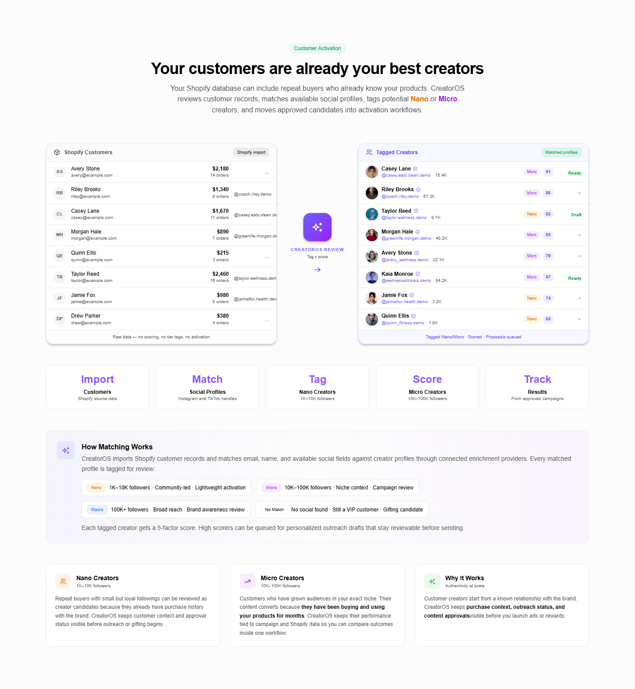

<div align="center">

# CreatorOS

**Discover. Activate. Whitelist.**

The operating system for creator programs: turn your best customers into creators, run reviewed outreach and product gifting, and manage whitelisted ads from one dashboard.

[**Live demo**](https://creatoros-public.netlify.app) · [Features](#features) · [Getting started](#getting-started) · [Tech stack](#tech-stack)


<a href="https://creatoros-public.netlify.app">
  
</a>

</div>

## Why CreatorOS

Most brands hunt for influencers from scratch, but their best creators are often already in their Shopify customer list: repeat buyers who know and love the product. CreatorOS imports those customers, matches them to their social profiles, scores them, and moves the best fits through outreach, gifting, agreements, and whitelisted ads, with a human review step before anything goes out.

It's built for **DTC brands** running their own creator programs and for **agencies** managing many client brands from separate, isolated workspaces.

## The workflow

| Step | What happens |
| --- | --- |
| **1. Connect Shopify** | Import customers with purchase history, order frequency, and lifetime value. |
| **2. AI scoring** | Match customers to Instagram and TikTok profiles and score each one on five factors. |
| **3. Reviewed outreach** | Draft personalized proposals for high scorers, then approve every message before it sends. |
| **4. Onboard and gift** | Move approved creators into Shopify draft orders, discount codes, and product bundles. |
| **5. Whitelist and measure** | Run Meta Partnership Ads and TikTok Spark Ads, then compare creator ads to brand ads. |



## Features

### Discover and score creators

- **Creator discovery:** search Instagram and TikTok for creators in your niche through connected enrichment providers (Apify or Scrapling), then import them straight into your pipeline.
- **5-factor AI scoring:** every creator gets a composite score from engagement, niche fit, audience quality, content quality, and brand affinity. Shopify purchase data (lifetime spend, orders, VIP tier) enriches the profile when available.
- **Creator roster:** browse creators in card or table view with filtering, sorting, and tier tags (Nano, Micro, Macro).
- **Applications:** a public, brand-branded application page (`/apply/[brandId]`) where creators can apply, plus a review queue to approve or decline them.

### Turn customers into creators

- **Shopify import:** pull in existing customers and keep their order history attached.
- **Customer activation:** segment customers by whitelisting readiness. Verified Instagram creators can run Partnership Ads, and email-only VIPs are routed to Klaviyo outreach.
- **Profile matching:** match customer emails, names, and social fields to creator profiles, then tag each match as Nano (1K–10K), Micro (10K–100K), Macro (100K+), or "No match" (still a gifting candidate).



### Outreach and partnerships

- **Visual pipeline:** a drag-and-drop Kanban board that tracks every creator from Discovered → Contacted → Onboarded → Active.
- **Messages:** one inbox for every creator conversation, with AI-drafted messages, delivery tracking, and follow-up queues. Email goes out through Resend, with Mailgun as a fallback.
- **AI proposals:** AI-written partnership proposals that you review and approve before sending.
- **Content briefs:** saved creator briefs with scripts, visual notes, guidelines, and review-ready details.
- **Agreements:** track whitelisting terms, usage rights, compensation, and signature status for each creator.

### Gifting, rewards, and payouts

- **Product gifting:** send products to creators through Shopify draft orders and track fulfillment all the way to content delivery.
- **Product catalog:** browse Shopify products and variants available for gifting.
- **Milestones:** track creator achievements and fulfill milestone-based rewards.
- **Payouts:** affiliate view economics, accrued creator earnings, and a payout ledger. Creator payouts stay separate from merchant billing.

### Whitelisted ads and analytics

- **Campaigns:** track whitelisted and brand ad performance across Meta and TikTok.
- **Performance analytics:** creator leaderboards, campaign comparisons, creator-ads-vs-brand-ads ROAS, and pipeline growth charts.

### AI assistant and support

- **Atlas:** an AI "Head of Creator Partnerships" built into the dashboard. It answers questions about your program and can run actions against the active workspace, with a preview or confirmation step before anything live (outreach, payouts, shipments, agreements, billing).
- **AI tools:** automation for outreach, content briefs, and creator analysis.
- **Support desk:** an AI-assisted ticket queue, plus an embeddable support widget (`/support-widget/[brandId]`) for each brand.

### Built for agencies

- **Multi-brand workspaces:** switch between client brands, with each workspace scoped to its own data, provider credentials, proposals, and reporting.
- **Team and roles:** organization members, roles, and per-workspace access, powered by Clerk Organizations.
- **Integration center:** connect Shopify, Meta, TikTok, Klaviyo, Resend or Mailgun, and Apify or Scrapling separately for each brand.
- **Billing:** subscription plans and usage limits through Clerk Billing.

## Getting started

```bash
git clone https://github.com/Biznomad/CreatorOS-public.git
cd CreatorOS-public
cp env.example.txt .env.local   # fill in your keys
npm install
npm run dev
```

Open [http://localhost:3000](http://localhost:3000). If that port is taken, run `PORT=3100 npm run dev`.

### What you'll need

- **Backend API:** this repo is the dashboard. Live data comes from a separate FastAPI backend (not included) through the built-in proxy at `/api/proxy`. Set `NEXT_PUBLIC_WHITELABEL_API` to your backend URL.
- **Clerk:** a publishable key and secret key for sign-in, organizations, and billing. See [docs/clerk_setup.md](./docs/clerk_setup.md).
- **Providers (optional):** Shopify, Meta, TikTok, Klaviyo, Resend or Mailgun, and Apify or Scrapling. These can go in `.env.local` or be saved per brand under **Dashboard → Settings → Integrations**. All variables are listed in [`env.example.txt`](./env.example.txt).

The landing page, legal pages, and dashboard UI all run without a backend. Features that read or write live data need one.

### Onboarding a brand

1. Create or select a brand from the brand switcher.
2. Open `/dashboard/integrations` and connect the brand's providers.
3. Open `/dashboard/shopify` for the guided Shopify setup and customer import.

When the backend is unreachable in local development, the onboarding endpoints fall back to a local store at `.gstack/local-launch-store.json`. Only non-secret setup state is saved there.

## Tech stack

| Area | Tools |
| --- | --- |
| Framework | Next.js 16 (App Router), React 19, TypeScript |
| UI | shadcn/ui, Tailwind CSS 4, Recharts, dnd-kit |
| Data | TanStack Query, nuqs (URL state), Zustand |
| Forms | TanStack Form + Zod |
| Auth and billing | Clerk (organizations, RBAC, billing) |
| Monitoring | Sentry |
| Hosting | Netlify (`netlify.toml` included) or any Node host |

## Scripts

| Command | Description |
| --- | --- |
| `npm run dev` | Start the dev server |
| `npm run build` | Production build |
| `npm run start` | Serve the production build |
| `npm run lint` | Lint with oxlint |
| `npm run format` | Format with oxfmt |
| `npm run verify:production` | Build, start, and smoke-test the app |
| `npm run verify:shopify` | Shopify policy preflight checks |

## Project docs

- [AGENTS.md](./AGENTS.md): project structure, conventions, and data-fetching patterns
- [docs/forms.md](./docs/forms.md): the form system
- [docs/themes.md](./docs/themes.md): themes and fonts
- [docs/nav-rbac.md](./docs/nav-rbac.md): navigation access control
- [docs/clerk_setup.md](./docs/clerk_setup.md): Clerk setup

## License

MIT. Built on the [Kiranism shadcn dashboard starter](https://github.com/Kiranism/next-shadcn-dashboard-starter). Made by [Biznomad](https://biznomad.io).
